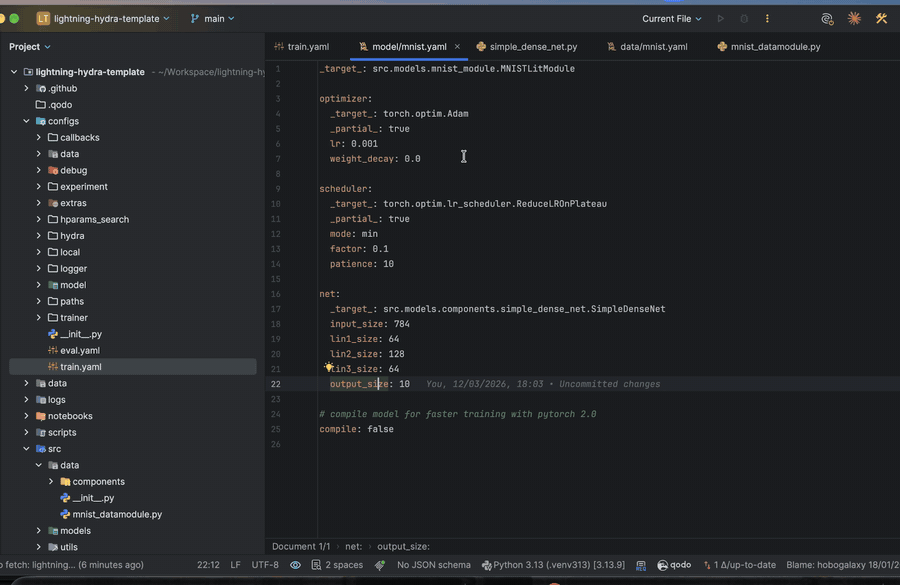
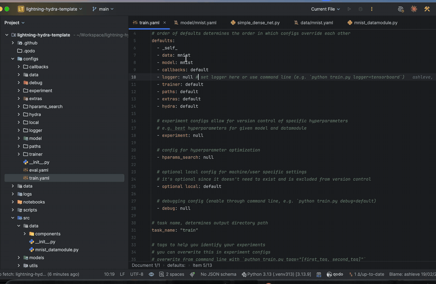
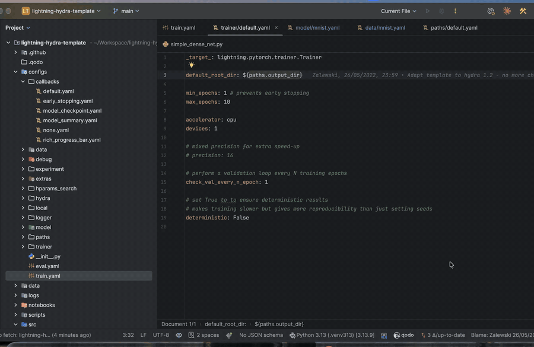
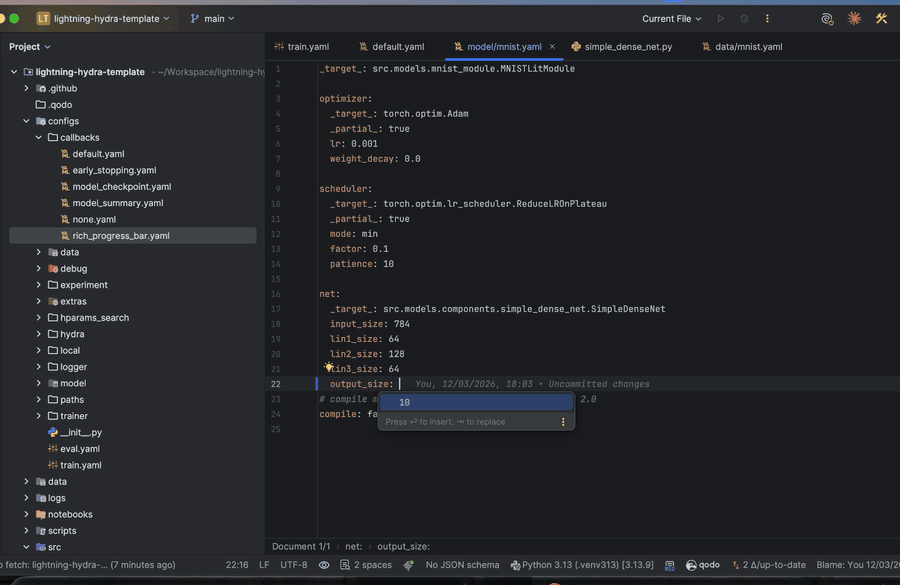

# Hydra Defaults Navigation (PyCharm plugin)

[](https://plugins.jetbrains.com/plugin/35797)
[](https://plugins.jetbrains.com/plugin/35797)
[](https://github.com/saifjarboui/pycharm-hydra-nav/actions/workflows/build.yml)

<!-- Plugin description -->


Cmd/Ctrl+click on a Hydra `defaults:` entry opens its file:

```yaml
defaults:
  - model: resnet                # → <config root>/model/resnet.yaml
  - override /trainer: gpu       # → <config root>/trainer/gpu.yaml
  - data@eval: cifar10           # → <config root>/data/cifar10.yaml
  - base                         # → base.yaml next to this file
```

The plugin looks for `<group>/<option>.yaml` in the current file's folder, then in each folder above it, and opens the first match. It needs no setting. Renaming the target file updates the entry.



Cmd/Ctrl+click on a `_target_` opens the Python code it names, one dotted segment at a time:

```yaml
_target_: src.models.resnet.ResNetClassifier   # click the class → the class, `resnet` → the module
_target_: src.models.resnet.ResNetClassifier.from_config   # a method or nested class works too
```

PyCharm's own import resolver does the lookup, so re-exports like `torch.optim.Adam` and installed packages work too. Renaming the class or module updates the entry.



Cmd/Ctrl+click on an interpolation opens the key it reads:

```yaml
img_size: ${data.image_size}   # → image_size: in data/*.yaml (a chooser if several data options define it)
seed: ${seed}                  # → seed: in this file or a primary config such as train.yaml
```

Which `data` option runs is only known at run time, so every candidate is offered. `${oc.env:...}`-style resolvers and relative `${..x}` aren't linked.

Cmd/Ctrl+click on a key beside `_target_` opens that parameter of the target's `__init__`, and renaming the parameter updates the key. F1 on a `_target_` segment shows the Python docs.

```yaml
_target_: src.models.resnet.ResNetClassifier
lr: 1e-4          # → the `lr` parameter of ResNetClassifier.__init__
```

Ctrl+Space completes `defaults:` options (the `*.yaml` files of the group), `_target_` paths (packages, modules, classes, methods) and `${...}` keys.



These also pop up while you type:

- On a `defaults:` line, the group keys (`- mo` or `- override /mo` → `model: `), from the group folders next to the config.
- On a new key in a `_target_` block, the parameters not set yet (of `__init__`, or of the method), plus `_partial_`, `_recursive_` and `_convert_`.
- On the value of such a key, the parameter's `Literal[...]` values, `true`/`false` for `bool`, `null` for `Optional`, and its default.

The `_target_` suggestions look up the Python code on each keystroke in that block. PyCharm caches the lookup.

Code > HydraNav: Hide Comments and Docs (also in the editor's right-click menu) toggles folding of every comment and Python docstring in the current editor. A green check shows next to it while they're hidden. Bind a shortcut to it in Keymap if you want one.
<!-- Plugin description end -->

## Build and install

```bash
export JAVA_HOME=~/Applications/PyCharm.app/Contents/jbr/Contents/Home   # PyCharm's own Java
./gradlew test buildPlugin
```

Then in PyCharm: Settings → Plugins → ⚙ → Install Plugin from Disk… → `build/distributions/pycharm-hydra-nav-*.zip`.

`./gradlew runIde` opens a test PyCharm with the plugin loaded.

The build downloads PyCharm `pycharmVersion` (`gradle.properties`). To build against a local install instead, set `pycharmPath=/path/to/PyCharm.app` in `~/.gradle/gradle.properties`.

`./gradlew verifyPlugin` runs the Plugin Verifier against the supported PyCharm releases.
